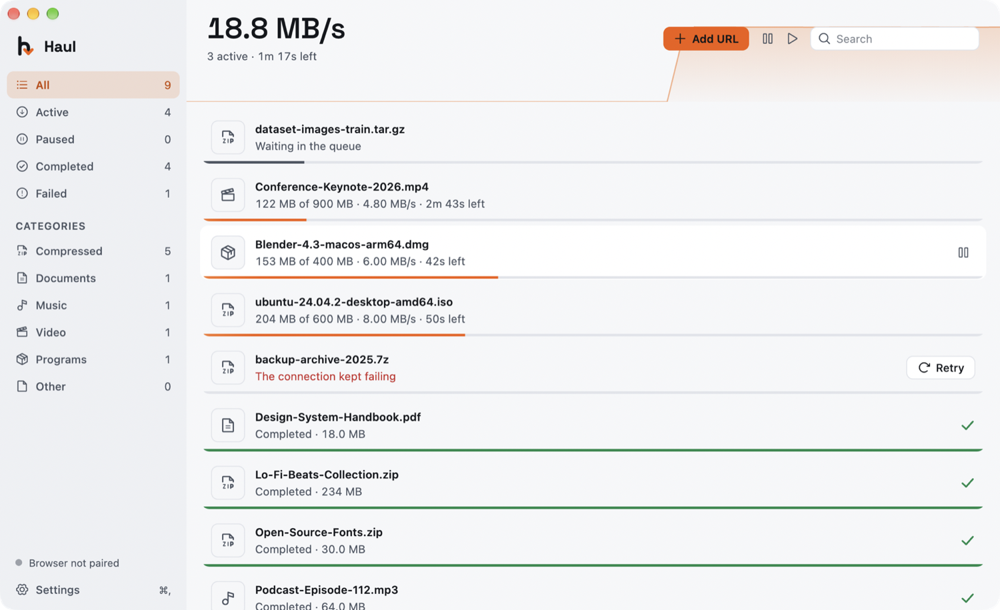

<p align="center">
  <picture>
    <source media="(prefers-color-scheme: dark)" srcset=".github/assets/banner-dark.png">
    
  </picture>
</p>

<p align="center">
  <strong>A fast, open-source download manager for the Mac.</strong><br>
  Segmented downloads, pause and resume, and a Chrome and Firefox extension that hands your browser's big downloads to Haul.
</p>

<p align="center">
  
  
  
</p>

<p align="center">
  <picture>
    <source media="(prefers-color-scheme: dark)" srcset=".github/assets/screenshot-dark.png">
    
  </picture>
</p>

## Features

- **Faster, sturdier downloads:** a file is split into up to 8 parts that download at once, and idle connections take over the slowest part so the end doesn't drag.
- **Pause, resume, retry:** carry on from the exact byte, even after a restart or a dropped connection.
- **A queue you control:** limit how many run at once, set a speed limit, and use a proxy or site logins.
- **Takes over browser downloads:** the Chrome and Firefox extension sends big files to Haul and keeps your logins working.
- **Lives in the menu bar:** close the window and downloads carry on; banners and sounds tell you when they finish.
- **Native and small:** a Mac app with light and dark themes, no ads and no accounts. Apart from your downloads, the only thing it contacts is GitHub, once a day, to see whether a newer version exists (you can switch that off).

## Install

1. Open the downloaded `Haul-<version>.dmg` and drag **Haul** onto the **Applications** shortcut.
2. Open Haul from Applications. Releases that are not yet signed with an Apple
   Developer ID (the release notes say when that is the case) are blocked the
   first time: open **System Settings, Privacy & Security**, scroll to the
   message about Haul, press **Open Anyway**, and confirm. On macOS 14 and
   earlier, right-clicking Haul and choosing **Open** also works. You only do
   this once. If macOS says the app is damaged, run
   `xattr -dr com.apple.quarantine /Applications/Haul.app` in Terminal.
3. Close the window whenever you like. Downloads keep running, and Haul stays
   in the menu bar. Click its icon, or the Dock icon, to bring the window back;
   Command-Q quits (it asks first if downloads are running).

To add a download without a browser, press **Command-N** (or paste a link with
Command-V, or drop a link on the window), check the file name and folder, and
press Start.

## Take over downloads from your browser

Haul has an extension for Chrome and Firefox. With it, clicking a download link
for a zip, disk image, video and so on sends the file to Haul instead of the
browser.

### 1. Install the extension

- **Chrome:** (Edge and Brave load it the same way, but only Chrome has been tried) unzip `haul-chrome-<version>.zip` to a folder you
  will keep. Open `chrome://extensions`, switch on **Developer mode**, press
  **Load unpacked**, and choose that folder. (Once Haul is in the Chrome Web
  Store, install it from there instead.)
- **Firefox:** open `about:debugging`, choose **This Firefox**, then **Load
  Temporary Add-on**, and pick `manifest.json` inside the unzipped
  `haul-firefox-<version>.zip`. A temporary add-on goes away when Firefox quits;
  once Haul is published on Firefox Add-ons, install it from there. Firefox also
  asks you to allow the add-on to access your data on all websites (the
  add-on's Permissions tab); it needs this to see where a download comes from.

### 2. Pair it with the app

The extension and the app share a secret token, so no other program on your Mac
can send downloads to Haul.

1. In Haul, open **Settings** (Command-comma), **General**, and press **Copy
   token**.
2. In the browser, open the extension's **Options** (right-click its icon, or
   press Options in its popup). Paste the token into **Pairing token**.
3. Press **Test connection**. It should say *Connected to Haul*, with the version Haul's
   Settings then shows the status as Connected.

You only do this once. If you ever change the **Port** in Haul's Settings,
change it in the extension's Options too.

### 3. Download something

Click a link to a `.zip`, `.dmg`, `.mp4` or any other file type on the list.
Haul comes to the front with the **Add a download** dialog already filled in and
marked *Sent by Chrome*; press **Start**. (To skip the dialog, switch on
**Start browser downloads at once** in Settings, General; Haul then shows a
banner instead.) The browser's own download is cancelled and does not appear in
its downloads list.

- Right-click any link and choose **Download with Haul** to send a file the
  extension would not take on its own.
- Files that need you to be signed in work: the browser's cookies go to Haul
  with the link.
- The extension's toolbar button has an on/off switch and says whether Haul is
  reachable.

Which file types, the minimum size, and which sites to leave to the browser are
set in Haul: **Settings, File types**. The extension follows them within about
a minute.

## Settings

Open with **Command-comma**. Every change takes effect at once, and each pane
has **Reset this pane**.

| Pane | What it does |
| --- | --- |
| General | Open at login, start hidden, resume downloads on launch, keep the Mac awake while downloading, the browser link (status, port, token), start browser downloads at once |
| File types | The categories, their extensions and folders; which file types the browser extension takes over; sites it never takes over |
| Save to | The default folder, a folder per category, and remembering the last folder you chose |
| Downloads | How many run at once, what to do with a link already in the list, removing finished downloads |
| Connection | Connections per download, a speed limit, retries, a stall timeout, per-site connection limits |
| Proxy | None, the system proxy, or an HTTP proxy with a bypass list; **Test proxy** checks it |
| Site logins | A user name and password for sites that ask (kept in the Keychain) |
| Notifications | Banners and sounds for finished, failed and all-done |
| Appearance | System, light or dark; compact or comfortable rows; speed in the menu bar |
| About | The version, this README, licences, and Reset all settings |

## Known limits

- **Haul must be running** for browser downloads to be taken over. With Haul
  closed, the browser downloads the file as usual.
- **One-time links:** a few sites make a link that works only once. The browser
  may use it up before Haul asks for it, and Haul's attempt then fails; use the
  browser for those.
- **Servers that limit connections per person** give Haul fewer than the
  connections you asked for.
- **Servers that cannot resume** download over one connection, and pausing them
  warns you that they will start over.
- **Pairing is manual:** you copy the token once.
- **Dragging a link from a browser's address bar** onto Haul does not work yet
  (it needs a newer Flutter); copy the link and paste it instead.
- The retry count and the stall timeout apply from the next time Haul starts.

## Troubleshooting

### The extension says "Haul did not answer" or "app not reachable"

Work down this list; stop when it works.

1. **Is Haul running?** Look for its icon in the menu bar. Open Haul.
2. **Is browser integration on?** Haul's Settings, General: **Take over
   downloads from browsers** must be on.
3. **Is the port the same on both sides?** Haul's Settings, General shows the
   Port (47821 unless you changed it); the extension's Options must have the
   same number. If Haul says the port is in use by another app, choose another
   port in Haul and the same one in the extension.
4. **Press Test connection** in the extension's Options. *Haul did not accept
   this token* means the token is wrong or old: press **Copy token** in Haul
   again and paste it fresh.
5. **Check from Terminal:** `curl http://127.0.0.1:47821/v1/ping` should print
   `{"app":"Haul",...}`. If it does not, something is blocking the port; try a
   different one.

### A download was not taken over

- The file type or size may not be on Haul's list (Settings, File types), or the
  site may be on the never-take-over list.
- The popup's switch may be off.
- `blob:` and `data:` downloads (made by a page's own script) always stay with
  the browser.

### A download fails

The row says why in plain words. **Retry** tries again; a link that says
*This link has expired* or *needs a login* offers **New link**, or save a login
under Settings, Site logins.

## Building from source

```
scripts/build_release.sh            # analyze, test everything, build the app
extension/build.sh package          # the two extension zips, in extension/dist
HAUL_SIGN_IDENTITY="Developer ID Application: Your Name (TEAMID)" \
HAUL_NOTARY_PROFILE=haul-notary \
  scripts/sign_notarize.sh          # sign, notarize and make the DMG in dist/
```

The repository holds:

```
app/                    The Flutter app (macOS), built on Cubits
packages/download_engine/   The download engine: pure Dart, no Flutter
extension/              The Chrome and Firefox extension (plain JavaScript)
scripts/                Release, signing and packaging scripts
```

To add
Windows or Linux later, implement the interfaces in `app/lib/services/system`
(platform services, window, tray, notifier, login item, sleep blocker) and return
them from each `current` getter; the engine and the screens need no change.

## Licence

Haul is free software.

- The app, the browser extension and the scripts are licensed under the
  **GNU General Public License v3.0 or later** ([LICENSE](LICENSE)).
- The download engine (`packages/download_engine`) is licensed under the
  **GNU Lesser General Public License v3.0 or later**
  ([LICENSE](packages/download_engine/LICENSE)), so other programs can use it as
  a library.

Copyright © 2026 Abdulalim Ladan. This program comes with no warranty. The
open-source software and fonts Haul is built from are listed in
[THIRD_PARTY.md](.github/THIRD_PARTY.md). Contributions are welcome: see
[CONTRIBUTING.md](.github/CONTRIBUTING.md).

